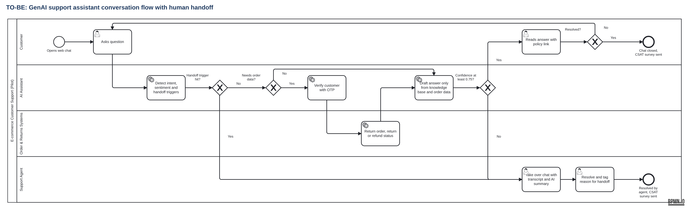
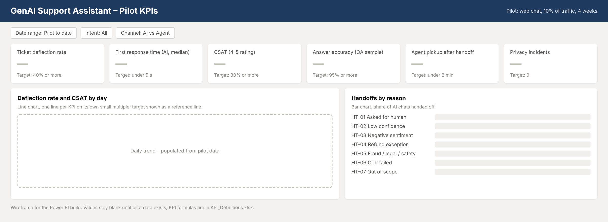

# GenAI Customer Support Assistant – E-commerce

**Role:** Business Analyst  **Tools:** Jira, Confluence, BPMN 2.0, Power BI

An online retailer wants an AI chat assistant to answer **order status, return and refund** questions so agents can focus on complex cases.
A GenAI assistant can give wrong answers, expose personal data or leave customers stuck. For that reason, I wrote the **guardrails as testable acceptance criteria**, not as a separate policy document.

## Conversation flow with human handoff

## Guardrails at a glance

| Category | Rules | Examples |
|---|---|---|
| Human handoff triggers | HT-01 – HT-07 | Customer asks for a human · 2 low-confidence turns · negative sentiment · refund exception above ₹5,000 · fraud/legal/safety · 3 failed OTPs |
| Accuracy | AG-01 – AG-06 | Answers only from approved knowledge base and live order data · confidence threshold 0.75 · never invent order data · policy link on every answer · 95% accuracy in weekly QA |
| Data privacy | PG-01 – PG-06 | OTP before order details · masked personal data · no card/CVV/UPI PIN · PII redacted before the LLM · 90-day retention · AI disclosure (DPDP Act 2023) |

## Success KPIs

| KPI | Pilot target |
|---|---|
| Ticket deflection rate | 40% or more |
| First response time (AI, median) | Under 5 seconds |
| CSAT | 80% or more, and no lower than agent-only chats |
| Answer accuracy · Handoff rate by reason · Privacy incidents | 95% or more · monitored · 0 |

## Deliverables

| Deliverable | File |
|---|---|
| Requirements specification: scope, elicitation with 3 personas, conversation flow, 19 guardrails, 18 user stories, KPIs, pilot plan | [`docs/Requirements_Specification_GenAI_Support_Assistant.docx`](docs/Requirements_Specification_GenAI_Support_Assistant.docx) |
| Same content formatted for a Confluence page | [`docs/Confluence_Requirements_Page.md`](docs/Confluence_Requirements_Page.md) |
| 18 user stories with acceptance criteria (Must 12 · Should 4 · Could 2), ready for Jira import | [`jira/genai_assistant_user_stories_jira_import.csv`](jira/genai_assistant_user_stories_jira_import.csv) |
| Pilot UAT plan: entry/exit criteria, roles, defect severity, **25 test scenarios** (order status 5 · returns 5 · handoff 6 · accuracy 4 · privacy 5) | [`testing/Pilot_UAT_Plan.xlsx`](testing/Pilot_UAT_Plan.xlsx) |
| KPI definitions and Power BI dashboard wireframe | [`kpi/`](kpi/) |
| Conversation flow in BPMN 2.0 (open in [demo.bpmn.io](https://demo.bpmn.io)) | [`process/`](process/) |

> Portfolio project. The company and personas are representative and were used to practise writing requirements for a GenAI product.
