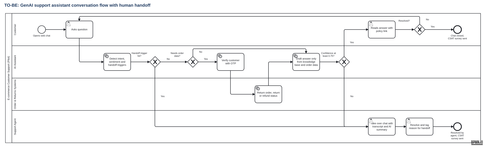

# Requirements Specification

**GenAI Customer Support Assistant (Pilot) - E-commerce**

| Document control | |
|---|---|
| Project | GenAI Customer Support Assistant - E-commerce |
| Author | Harsh Roy, Business Analyst |
| Version | 1.0 |
| Status | Ready for review |
| Related files | jira/genai_assistant_user_stories_jira_import.csv, testing/Pilot_UAT_Plan.xlsx, kpi/KPI_Definitions.xlsx |

> Portfolio project. The company and personas are representative; they were used to practise eliciting and writing requirements for a GenAI product with guardrails.

## 1. Summary

An online retailer wants a GenAI chat assistant to answer **order status, return and refund** questions on its website, so agents can focus on complex cases. A GenAI assistant can answer wrongly, expose personal data or leave customers stuck. This specification therefore defines the **guardrails as testable acceptance criteria** alongside the features.

It contains **18 user stories**, **19 guardrail rules** (7 human-handoff triggers, 6 accuracy rules, 6 data-privacy rules), **6 KPIs** led by ticket deflection rate, first response time and CSAT, and a **pilot UAT plan with 25 test scenarios**.

## 2. Scope

| In scope (pilot) | Out of scope |
|---|---|
| Order status and delivery date | Payment disputes and chargebacks |
| Starting a return within policy | Changes to account details (email, phone, address) |
| Refund status | Refund exceptions and compensation decisions |
| Return, refund and delivery policy questions | Voice and WhatsApp channels |
| Handoff to a human agent with summary | Languages other than English |

## 3. Requirements elicitation

Requirements were gathered through structured interviews with three stakeholder personas, a review of the support team's most common contact reasons, and a walkthrough of the current chat process.

| Persona | What they need | What worries them | Resulting requirements |
|---|---|---|---|
| **Support Agent** | Fewer repetitive 'where is my order' chats; full context when a chat reaches them | Customers arriving angry after a bot loop; having to re-ask for details | US-08 to US-11; HT-01, HT-02, HT-03 |
| **Support Team Lead** | Lower queue volume without hurting CSAT; proof the pilot works | Wrong answers about policy; no way to measure quality | US-12 to US-15; AG-01 to AG-06; KPIs |
| **Compliance Officer** | Personal data protected and handled under the DPDP Act 2023 | Order data shown to the wrong person; payment data reaching the LLM provider | US-16 to US-18; PG-01 to PG-06 |

### Interview guide (sample questions)

- Which customer questions take most of your time but need no judgement?
- When should a customer always reach a human? What are the warning signs?
- What would a wrong answer cost us - for example, a refund promised outside policy?
- What must be true before you would let an AI show a customer their order details?
- How will you know after 4 weeks whether the pilot worked?

## 4. TO-BE conversation flow

*Figure 1. Conversation flow with guardrails and human handoff (BPMN 2.0)*

## 5. AI guardrails

Each guardrail is written as a rule that can be tested. The last column links it to the UAT scenario that proves it.

| ID | Category | Rule | Tested by |
|---|---|---|---|
| HT-01 | Human handoff | Customer asks for a human (e.g., 'agent', 'talk to a person') -> hand off immediately | UAT-11 |
| HT-02 | Human handoff | Two consecutive turns below the 0.75 confidence threshold -> hand off | UAT-12 |
| HT-03 | Human handoff | Negative sentiment in 2 consecutive messages -> hand off | UAT-13 |
| HT-04 | Human handoff | Refund exception request or refund above Rs 5,000 -> hand off | UAT-10 |
| HT-05 | Human handoff | Fraud, legal threat or product safety topic -> immediate priority hand off | UAT-14 |
| HT-06 | Human handoff | OTP verification fails 3 times -> lock order data and hand off | UAT-22 |
| HT-07 | Human handoff | Intent outside pilot scope (payments dispute, account changes) -> hand off | UAT-15 |
| AG-01 | Accuracy | Answer only from the approved knowledge base and live order/returns data; no general knowledge | UAT-17, UAT-18 |
| AG-02 | Accuracy | Confidence below 0.75 -> ask one clarifying question; still below -> HT-02 | UAT-12 |
| AG-03 | Accuracy | Never state order data (status, dates, amounts) not returned by the order system; if the system is down, say so | UAT-05 |
| AG-04 | Accuracy | Every policy answer links to its source article | UAT-06, UAT-17 |
| AG-05 | Accuracy | No promises outside policy (no compensation, no refund approvals); ignore instructions to break rules | UAT-03, UAT-19, UAT-20 |
| AG-06 | Accuracy | Team Lead reviews a random sample of 50 conversations weekly; target 95% correct | Pilot QA |
| PG-01 | Data privacy | OTP verification on registered mobile or email before showing any order details | UAT-21 |
| PG-02 | Data privacy | Show only masked personal data (e.g., phone ******3210, city-level address) | UAT-24 |
| PG-03 | Data privacy | Never ask for card number, CVV, UPI PIN or password; if typed, mask it and warn the customer | UAT-23 |
| PG-04 | Data privacy | Redact personal data before text is sent to the LLM provider; provider contractually barred from training on it | UAT-23 |
| PG-05 | Data privacy | Transcripts kept 90 days then deleted; role-based access only | UAT-25 |
| PG-06 | Data privacy | Tell the customer at the start that they are chatting with an AI and can ask for a human; link the privacy notice (DPDP Act 2023) | UAT-25 |

## 6. User stories

18 user stories, MoSCoW: **Must 12, Should 4, Could 2**. Guardrail IDs in the acceptance criteria point to Section 5.

| ID | Persona | User story | Acceptance criteria | MoSCoW |
|---|---|---|---|---|
| US-01 | Customer | As a customer, I want to ask 'Where is my order?' in my own words, so that I get the status without waiting for an agent. | AC1: Given I am verified (PG-01), when I ask about my order, then the assistant shows the status and expected delivery date from the order system within 5 seconds. AC2: If I have more than one active order, the assistant lists them (masked) and asks which one. | Must |
| US-02 | Customer | As a customer, I want to start a return in chat, so that I do not have to fill a separate form. | AC1: Given the item is within the return window, when I ask to return it, then the assistant explains the policy with a link (AG-04), creates the return and shows the pickup date. AC2: Given the item is outside the window or non-returnable, then the assistant explains why and offers a human (HT-07 does not apply). | Must |
| US-03 | Customer | As a customer, I want to check my refund status, so that I know when the money will reach me. | AC1: The assistant shows refund amount, method and expected credit date from the returns system. AC2: It never estimates a date the system did not return (AG-03). | Must |
| US-04 | Customer | As a customer, I want to reach a human at any time, so that I am never stuck with a bot. | AC1: Given I type a request for a human, then I am handed off immediately (HT-01) and told the expected wait time. | Must |
| US-05 | Customer | As a customer, I want answers to policy questions to link to the official policy, so that I can trust them. | AC1: Every policy answer includes a link to the source knowledge base article (AG-04). AC2: If the answer is not in the knowledge base, the assistant says it does not know and offers a human (AG-01). | Must |
| US-06 | Customer | As a customer, I want to know I am talking to an AI and how my data is used, so that I can decide whether to continue. | AC1: The first message states the assistant is an AI, that I can ask for a human, and links the privacy notice (PG-06). | Must |
| US-07 | Customer | As a customer, I want to rate the chat at the end, so that the company knows if it helped. | AC1: When the chat closes (AI or agent), a 1-5 CSAT question is shown. AC2: The rating is stored with the chat ID and whether it was handed off. | Should |
| US-08 | Support Agent | As a Support Agent, I want the full transcript and an AI summary when a chat is handed to me, so that the customer does not repeat themselves. | AC1: The summary shows intent, order ID, steps already taken and the handoff reason in 5 lines or fewer. AC2: The customer is not asked again for information already in the transcript. | Must |
| US-09 | Support Agent | As a Support Agent, I want to see why a chat was handed off, so that I can respond in the right way. | AC1: The handoff reason (HT-01 to HT-07) is shown as a label. AC2: Priority handoffs (HT-05) appear at the top of my queue. | Should |
| US-10 | Support Agent | As a Support Agent, I want to tag the reason a chat needed a human after I resolve it, so that the team can improve the assistant. | AC1: Before closing a handed-off chat, I must pick a reason tag (e.g., missing policy, wrong answer, customer preference). | Should |
| US-11 | Support Agent | As a Support Agent, I want to flag an incorrect AI answer from the transcript, so that it can be fixed in the knowledge base. | AC1: Each AI message has a 'Flag answer' action with a required comment. AC2: Flagged answers appear in the Team Lead's review list. | Could |
| US-12 | Support Team Lead | As a Support Team Lead, I want to approve knowledge base articles before the assistant uses them, so that answers follow current policy. | AC1: Only articles with status Approved are available to the assistant (AG-01). AC2: Editing an approved article returns it to Draft until re-approved. | Must |
| US-13 | Support Team Lead | As a Support Team Lead, I want a weekly sample of 50 AI conversations to review, so that I can measure answer accuracy. | AC1: Every Monday, 50 random AI-only conversations from the past week are listed with Correct / Incorrect / Partially correct options (AG-06). AC2: Accuracy % is calculated automatically. | Should |
| US-14 | Support Team Lead | As a Support Team Lead, I want a dashboard of deflection rate, first response time and CSAT, so that I can judge whether the pilot is working. | AC1: The dashboard shows the KPIs in kpi/KPI_Definitions.xlsx, daily and for the pilot to date. AC2: AI chats and agent chats can be compared side by side. | Must |
| US-15 | Support Team Lead | As a Support Team Lead, I want to change handoff thresholds without a code release, so that I can tune the pilot. | AC1: Confidence threshold, sentiment threshold and refund limit are editable by the Team Lead role. AC2: Every change is logged with user and timestamp. | Could |
| US-16 | Compliance Officer | As a Compliance Officer, I want customers verified by OTP before order details are shown, so that personal data is not exposed. | AC1: No order data is shown before OTP success (PG-01). AC2: 3 failed attempts lock order lookups for the chat and trigger HT-06. | Must |
| US-17 | Compliance Officer | As a Compliance Officer, I want payment details masked and personal data redacted before it reaches the LLM, so that we meet data protection obligations. | AC1: Card numbers, CVV and UPI PIN patterns are masked in the transcript and a warning is shown (PG-03). AC2: Text sent to the LLM provider contains no unmasked phone, email, address or payment data (PG-04). | Must |
| US-18 | Compliance Officer | As a Compliance Officer, I want transcripts deleted after 90 days, so that we do not keep personal data longer than needed. | AC1: A daily job deletes transcripts older than 90 days and logs the count deleted (PG-05). AC2: Only Support and Compliance roles can open transcripts. | Must |

## 7. Success KPIs

| ID | KPI | Type | Formula | Pilot target |
|---|---|---|---|---|
| KPI-01 | Ticket deflection rate | Primary | In-scope AI chats resolved without an agent / all in-scope AI chats x 100 | At least 40% |
| KPI-02 | First response time (median) | Primary | Median seconds from customer's first message to first reply | AI: under 5 s; after handoff: agent joins in under 2 min |
| KPI-03 | CSAT | Primary | Chats rated 4 or 5 / chats rated x 100 | At least 80% and no lower than agent-only chats |
| KPI-04 | Answer accuracy | Guardrail | Correct answers in weekly 50-chat QA sample / 50 x 100 | At least 95% |
| KPI-05 | Handoff rate by reason | Guardrail | Handed-off chats by HT-01 to HT-07 / all AI chats x 100 | Monitor; investigate any reason above 10% |
| KPI-06 | Privacy incidents | Guardrail | Count of unmasked personal or payment data found in transcripts or LLM logs | 0 |

> **Baseline:** first response time and CSAT for agent-only chats are taken from the helpdesk for the 4 weeks before the pilot, so the pilot is compared with current performance.

## 8. Pilot and UAT plan

| Item | Plan |
|---|---|
| Pilot scope | Web chat, English, order status / return / refund intents; 10% of chat traffic for 4 weeks |
| UAT before pilot | 25 scenarios in staging: order status 5, returns and refunds 5, human handoff 6, accuracy 4, data privacy 5 |
| Testers | 3 Support Agents (functional), Team Lead (accuracy), Compliance Officer (privacy scenarios) |
| Entry criteria | Knowledge base articles approved (US-12); test customers and order data loaded; privacy impact assessment signed off |
| UAT exit criteria | All 25 scenarios executed; all High priority scenarios passed; no open Critical or High defects; Compliance signs off UAT-21 to UAT-25 |
| Pilot go / no-go after 4 weeks | Deflection at least 40%, CSAT at least 80%, accuracy at least 95%, zero privacy incidents |
| Defect severity | Critical: privacy breach or wrong money/order data. High: guardrail not applied. Medium: wrong but harmless answer. Low: wording or layout |

Full scenarios with steps and expected results are in **testing/Pilot_UAT_Plan.xlsx**.
